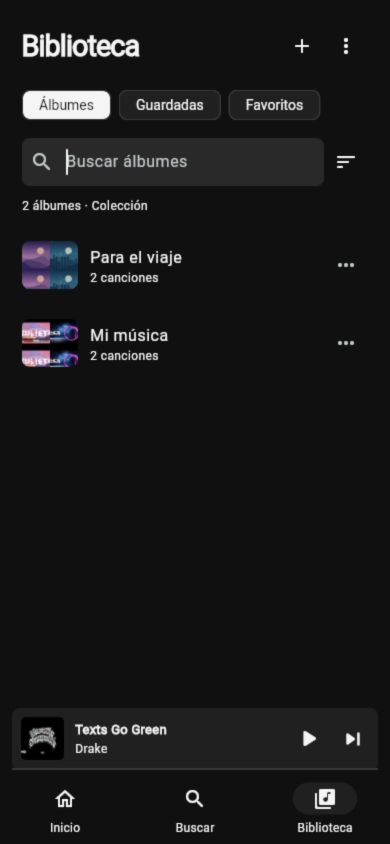
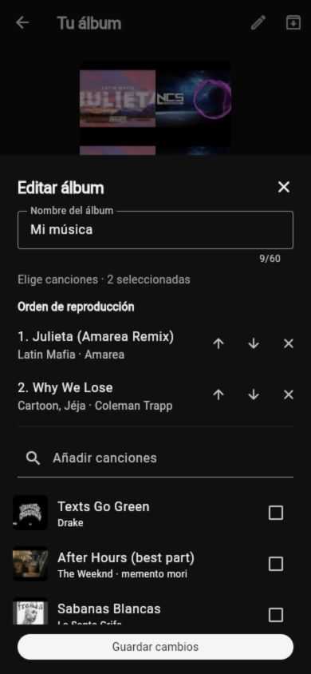
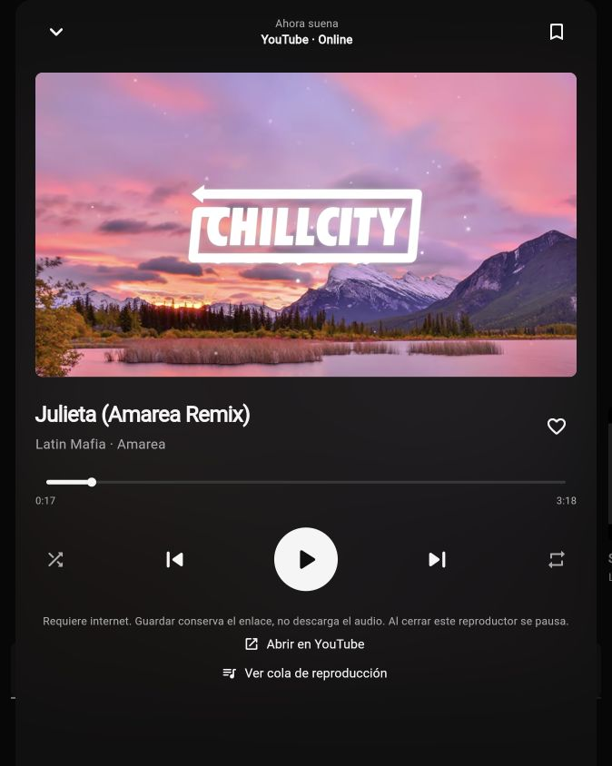
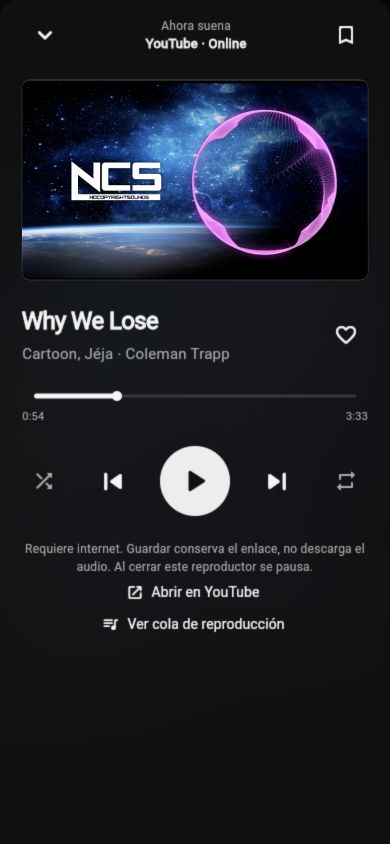
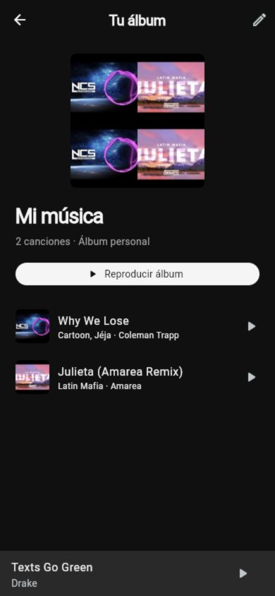
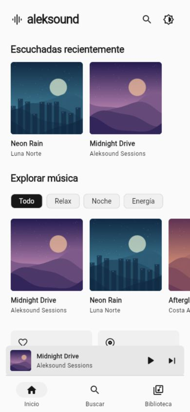
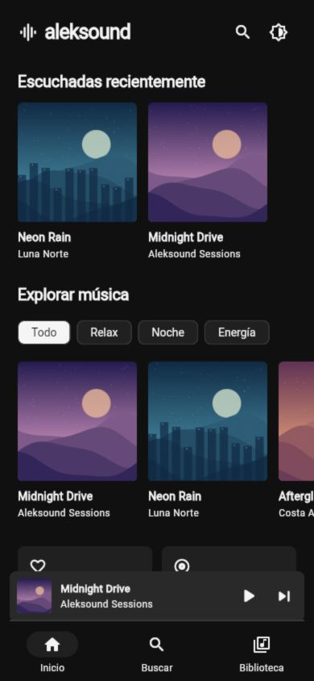
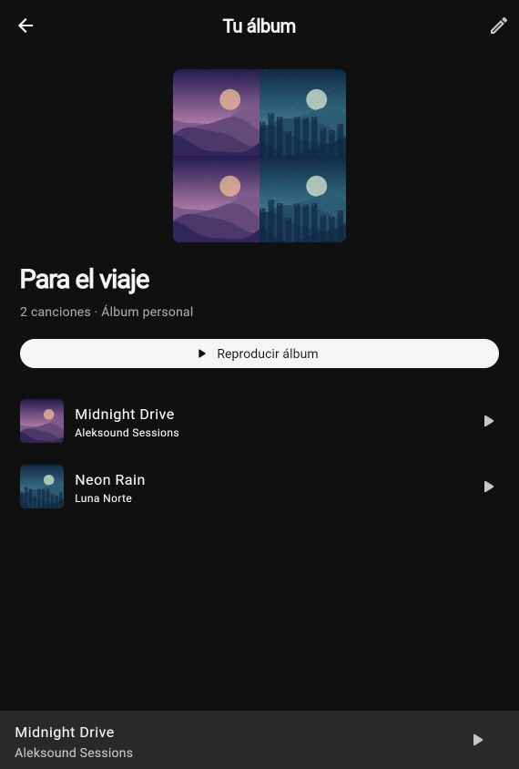
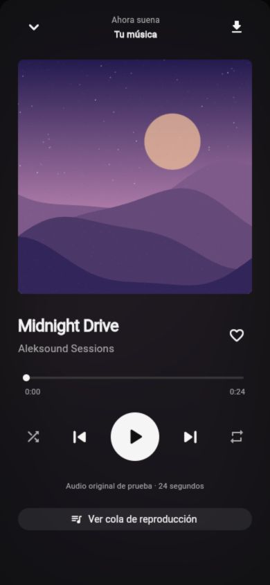

# Validación de Aleksound

## Documentación de uso diario y firma — 9 de octubre de 2026

Actualizados README, índice, guía de uso, instalación y guía Release para distinguir independencia del depurador de los requisitos de firma. Consultadas fuentes oficiales de Apple: [Modo desarrollador](https://developer.apple.com/documentation/xcode/enabling-developer-mode-on-a-device), [Release firmado para desarrollo](https://developer.apple.com/documentation/xcode/testing-a-release-build) y [Personal Team con perfil de siete días](https://developer.apple.com/help/account/basics/about-your-developer-account). La renovación se documenta como actualización, sin desinstalar ni borrar audios.

Esta tarea modifica documentación, no código: no se reinstaló la app, no se cerró Xcode, no se cambió el modo desarrollador ni se repitieron pruebas físicas. La evidencia de la instalación 0.6.3+9 corresponde al registro siguiente. [Instrucciones para el usuario](instalacion.md#usar-aleksound-sin-xcode).

Comprobación documental: 24 Markdown del producto, 15 notas de Aleksound en JARVIS, 207 enlaces locales y 92 wikilinks sin destinos ausentes; las 15 notas son alcanzables desde Inicio. AGENTS/CLAUDE/CODEX permanecen ignorados. Se actualizaron notas existentes, conservando historial.

## Barra, Descargas y portadas 0.6.3 — 9 de octubre de 2026

- Se reprodujeron primero los tres fallos: barra sigue en 10 s durante el gesto, Biblioteca selecciona Álbumes y Chachachá no tiene `artworkUri` local. Las regresiones fallaron por esos resultados antes de modificar producción.
- Causa de imagen comprobada: búsqueda con `img.youtube.com`; guardado previo limitado a `i.ytimg.com`. Índice inicial con siete registros y 20 archivos, la séptima canción sin `artworkFile`.
- `iphone_artwork_test.dart` aprobada en iPhone físico: imagen recuperada y decodificable, siete registros, archivos/bytes/duración de audio conservados. Comparación externa del índice confirma exactamente un cambio: añadir `artworkFile` a Chachachá; no se modificó ningún otro campo.
- `iphone_player_polish_test.dart` aprobada varias veces, incluida la revisión final: Biblioteca selecciona Descargas al entrar/reentrar, carátula local y gesto con motor real a **127,919 s**, sin consultas a la fuente de audio. Barra cambia durante el arrastre, el motor espera a soltar y el progreso corresponde al destino después. No mide latencia acústica ni sustituye percepción manual.
- `iphone_offline_test.dart` aprobada de nuevo: los seis finales originales y transiciones reales, pausa/seek/reanudación y MediaPlayer, con fuente remota deshabilitada. Conserva el conteo inicial de siete canciones; no borra la añadida por el usuario ni exige una biblioteca fija de seis. No se apagaron físicamente radios en esta prueba.
- Regresión Swift aprobada: ambos hosts, ID exacto, alternativas seguras, imagen válida y rechazo de HTML/placeholder/tamaño excesivo.
- Una revisión independiente detectó el gesto que seguía activo al avanzar de canción y el mensaje de Favoritos en Descargas vacías. Ambos se reprodujeron en pruebas fallidas y se corrigieron: validar la propiedad del gesto antes de seek y explicar la descarga con acceso a Buscar.
- **63 pruebas Flutter aprobadas**, análisis sin incidencias y compilación web correcta. Release **0.6.3+9**, 23,8 MB, compilada con `lib/main.dart`, instalada por actualización y lanzamiento confirmado. Firma existente conservada; ninguna desinstalación ni restablecimiento de preferencias.
- El almacenamiento contiene **21 archivos**: siete audios activos, seis originales de recuperación, siete JPG e índice. Índice conservado por la actualización final. No se revalidó individualmente cada álbum desde la interfaz.
- La ruta remota online no se reejecutó en esta corrección; su evidencia anterior pertenece a 0.6.2. El reporte genérico de IMG_0350 sigue pendiente de aclaración. Bloqueo/modo avión manual anterior no certifica llamadas/auriculares ni disponibilidad de todo video.

[Causa, uso y límites de los ajustes](ajustes-reproductor-biblioteca-portadas.md).

## Corrección de duración 0.6.2 — 9 de octubre de 2026

- Regresión reproducida en iPhone antes de corregir: Why We Lose informa 426,085 s cuando se esperan unos 213 s.
- Copia local del original: `afinfo` y `AVAudioFile` confirman 213,018 s; AVFoundation informa 426,085 s. Archivo completo, no transferencia parcial.
- Reempaquetado sin recomprimir mediante código nativo de producción. Prueba Swift confirma duración real, audio decodificado completo idéntico, original intacto y destino existente protegido.
- `iphone_offline_test.dart` ampliada pasó en iPhone físico: migración de seis archivos, reproducción, coherencia de duración, **final y avance real de las seis canciones**, fuente remota deshabilitada y duración de MediaPlayer correcta. Segunda ejecución reutiliza las reparaciones (`timingVersion: 1`), no duplica la migración.
- Índice del iPhone inspeccionado: seis registros, originales/carátulas conservados y duraciones corregidas. [Detalle y tabla](correccion-duracion-audio.md).
- Análisis sin incidencias y 56 pruebas Flutter aprobadas después de incorporar el finalizador.

- `iphone_online_timing_test.dart` aprobada por separado en iPhone físico: vista de descargas oculta solo en la prueba, resolución/preparación real, Why We Lose 213,018 s y cambio al final hacia Julieta 198,506 s; posición avanzando y sin marca descargada. Antes hubo una ejecución sin conexión y ejecuciones online fallidas, que no se cuentan como aprobadas. La ruta puede seguir recibiendo rechazos intermitentes.
- Reejecución física offline después de cambiar la ruta online: todos los seis finales/avance, duración de MediaPlayer, pausa/avance/reanudación y fuente remota deshabilitada aprobados.
- Verificación final: **60 pruebas Flutter aprobadas**, análisis sin incidencias y compilación web correcta. Release **0.6.2+8**, 23,8 MB, compilada con `lib/main.dart`, instalada mediante actualización y lanzamiento confirmado con `devicectl`.
- Inspección posterior: **19 archivos conservados** (seis audios reparados, seis originales, seis JPG e índice); sin desinstalación ni borrado de preferencias. No se volvió a inspeccionar cada álbum desde la pantalla.
- Documentación final: **23 Markdown y 135 enlaces locales**, sin destinos ausentes. AGENTS/CLAUDE/CODEX siguen ignorados; nota existente de JARVIS actualizada conservando historial. No se creó commit ni se publicó remoto.

Audición manual posterior a la corrección pendiente. El finalizador valida frames/duración y decodifica el final; la muestra de diagnóstico conserva todos los samples. Estas comprobaciones y el avance del reproductor no equivalen a oír personalmente el altavoz del iPhone. Confirmación previa de radios/bloqueo no se reutiliza como aceptación automática de esta corrección.

## Corrección 0.6.1 — 9 de octubre de 2026

Estado: **seis descargas completas y recuperación local verificadas en iPhone físico**. Modo avión, continuidad al bloquear y pausa/reanudación confirmados manualmente por Erick.

**Regresión reportada después de esa confirmación:** todas las canciones mostraban el doble de duración y quedaban sin sonido a mitad de la barra. Las pruebas cortas no cubrían el final. Se reabrió la aceptación y se corrigió en 0.6.2, con evidencia separada arriba; no borrar ese antecedente ni atribuirle las comprobaciones posteriores.

- Regresión del resolutor: la prueba nueva falló con el cliente IOS anterior y pasó con el cliente público VISIONOS, manteniendo ID exacto, rango completo, bytes y User-Agent de la consulta en la transferencia.
- `flutter test test --no-pub`: **56 pruebas aprobadas**; `flutter analyze --no-pub`: sin incidencias después de corregir los avisos del diagnóstico.
- Diagnóstico acotado en Mac recibió 3.449.148/3.449.148 bytes HTTP 200; solo contó bytes, no guardó esa música. No se usó como prueba de autonomía del teléfono.
- Primera transferencia aceptada en iPhone descubrió un fallo de AVFoundation por extensión `.part`. Reproducción local con archivo propio: `.m4a` duración 24 s y reproducible; archivo idéntico `.part` error -11828; `.part.m4a` vuelve a ser reproducible. Se corrigió el temporal conservando verificación antes del índice.
- Prueba física `iphone_audio_test.dart` aprobada: búsqueda C.R.O phonk, descarga real de Why We Lose, validación nativa del archivo, duración >60 s y reproducción local con posición >1 s. Se observaron en el contenedor M4A de 3,3 MB, JPG de 26 KB e índice `library.json`.
- Prueba física posterior `iphone_offline_test.dart` aprobada en un proceso nuevo, sin desinstalar: recupera audio y carátula `file:`, el controlador reproduce con cero consultas al resolutor deshabilitado; pausa, avance a 40 s, reanudación y MediaPlayer con título/tasa coherentes. **No equivale a radios apagadas físicamente.**
- `iphone_catalog_test.dart`: **seis casos aprobados**, IDs/versiones exactos, M4A y JPG locales, duración >60 s y posición >1 s. Texts Go Green, After Hours, Signs, Julieta y Sabanas Blancas descargaron en el primer intento de esa ejecución; Why We Lose ya estaba verificada. No se sustituyó ningún enlace.
- Nueva ejecución de `iphone_offline_test.dart`, ampliada a **las seis versiones**, aprobada: otro proceso recupera y reproduce todos los archivos/carátulas con cero peticiones al resolutor. La app conserva la biblioteca durante cada actualización.
- Durante el diagnóstico también hubo un HTTP 403 intermitente. Reintentar obtiene una URL nueva de la misma versión; una respuesta rechazada nunca se declara descargada.
- `flutter build web --no-pub`: correcto. `flutter build ios --release --no-pub --target lib/main.dart`: correcto, 23,7 MB; Info.plist confirma versión **0.6.1**, build **7**.
- Release instalada con `devicectl device install app`, sin desinstalar. Inspección posterior confirma **13 archivos**: seis M4A, seis JPG e índice. El intento de apertura automática encontró el teléfono bloqueado; se pidió abrir desde el icono, sin afirmar un lanzamiento automático exitoso.
- **Confirmación manual del usuario:** a la prueba «abrir Aleksound → Descargas, activar modo avión y apagar Wi-Fi, reproducir, bloquear y pausar/reanudar» respondió **«Sí, todo funciona»**. Se registra como reporte de Erick, no observación directa automatizada. No demuestra pruebas de llamadas, auriculares, AirPlay/Bluetooth, controles específicos del Centro de Control ni todas las versiones futuras.

## Núcleo iPhone 0.6 inicial — 9 de octubre de 2026 (histórico)

Estado en esa ejecución: **implementación parcial, objetivo offline sin completar**. El [núcleo actual](version-0.6-iphone.md) registra la corrección posterior.

- Suite final `flutter test test --no-pub`: **55 pruebas aprobadas**. Los nuevos casos cubren paginación/deduplicación, fin de resultados, respuestas tardías, cancelación durante resolución, refresco anterior a cancelación, archivos ausentes, persistencia de errores para reintento, importaciones simultáneas, selección AAC/identidad/DRM y metadatos originales tras descargar.
- `flutter analyze --no-pub`: sin incidencias.
- `flutter build web --no-pub`: compilación correcta.
- `flutter build ios --release --no-pub`, con `DEVELOPER_DIR` de Xcode: compilación correcta, app 23,7 MB, Bundle Identifier `com.erickvzh.aleksound`, equipo de firma existente conservado.
- Actualización instalada en el iPhone físico con `devicectl device install app`, seguida de lanzamiento confirmado con `device process launch`. Sin desinstalación ni borrado de preferencias. Release no necesita el depurador de Xcode para su lanzamiento; no equivale a firma permanente.
- Prueba física independiente `LOCAL_AUDIO_ONLY=true` aprobada: audio propio `midnight.wav` cargado, duración positiva y posición avanza más de un segundo. Se comprueban metadatos MediaPlayer, tasa 1, categoría `AVAudioSessionCategoryPlayback`, declaración de fondo y comandos habilitados. No se tocaron álbumes ni favoritos en esa prueba.
- JavaScriptCore inicializó y evaluó tanto una expresión simple como los módulos EJS en la prueba física remota.
- Búsqueda real `C.R.O phonk`: resultados no vacíos en la prueba física remota.
- Descarga completa de `Why We Lose`: **fallida, HTTP 403** en simulador y iPhone físico. No hay archivo de YouTube verificado ni evidencia de reproducción posterior en modo avión.
- Diagnóstico: formatos WEB/SABR sin URL, HEAD rechazado, comparación GET parcial/completo, cabeceras y red nativa compartida. La muestra parcial no certifica audio completo. Preferencia IPv4 reinició la conexión; no se incorporó al funcionamiento final. Se retiraron los adaptadores experimentales sin uso.
- Se mantuvo `--keep-app-running` en las ejecuciones físicas con `flutter drive`; evita la desinstalación que realiza la limpieza predeterminada del driver.
- AGENTS/CLAUDE/CODEX siguen ignorados en Git; no se creó commit ni se publicó el repositorio.
- Documentación: 22 Markdown del producto y 118 enlaces locales comprobados; ninguno apunta a un archivo ausente. No se comprobó cada destino externo ni cada ancla interna.

No se validaron bloqueo físico, Centro de Control mediante toques reales, llamadas, auriculares, Bluetooth, recuperación tras terminar el proceso, modo avión ni las seis versiones musicales. No extrapolar el éxito del motor propio al fallo del proveedor.

## Biblioteca 0.5 — 8 de octubre de 2026

- Verificación final: `flutter analyze --no-pub` sin incidencias; `flutter test --no-pub`, 42 pruebas aprobadas; `flutter build web --no-pub`, compilación correcta. Estos resultados incluyen las correcciones surgidas de la revisión.
- Inspección de Biblioteca, editor, archivados y respaldo en viewport de 390 × 844, respetando las paletas existentes.
- La búsqueda `mi musica` encuentra el álbum `Mi música` aunque no se escriban los acentos.
- Cambio real del orden de `Mi música`: Julieta primero y Why We Lose después; la pantalla del álbum refleja el orden guardado.
- Archivo del mismo álbum: desaparece de la colección activa, aparece en Archivados con dos canciones y se recupera sin perderlas. Al recuperarlo quedan dos álbumes activos y cero archivados.
- **Copiar respaldo** muestra confirmación de copia. Se leyó el texto exportado visible: formato `aleksound-library`, versión 1, una importación y dos álbumes. No se verificó el contenido del portapapeles del sistema fuera de la app.
- Restaurar `{` muestra «Pega una copia completa de Aleksound» y no habilita la combinación.
- Pegar la copia válida habilita la comprobación previa y muestra cantidades. La combinación real confirma que se conservaron las canciones y los álbumes anteriores.
- Tras recargar se conservan los dos álbumes y el nuevo orden de `Mi música`. Ordenar por Nombre muestra `Mi música` antes de `Para el viaje`.
- Reproducción desde el álbum reordenado: comienza Julieta, con progreso observado 0:22 / 3:18. Pausa confirmada; la cola contiene únicamente Julieta y Why We Lose en ese orden.
- Pruebas automatizadas nuevas: orden guardado, referencia ausente conservada, archivo recuperable, exportación/restauración, combinación repetida, nombres en conflicto, metadatos locales prioritarios, historial limitado e invalidación completa antes de escribir. Un fallo de escritura simulado verifica recuperación de preferencias previas. Una excepción durante la reversión no impide recuperar las demás preferencias.
- Dos regresiones de revisión reproducidas primero y corregidas: combinar 5.000 favoritos locales con uno nuevo se rechaza sin truncar; dos escuchas que llegan durante una escritura de restauración demorada se conservan en orden después de ella. La demora y los fallos se simulan solo en pruebas.
- Documentación final: 19 archivos Markdown y 74 enlaces locales comprobados, sin enlaces rotos. Instrucciones específicas de asistentes ignoradas y documentos del producto disponibles para Git.

El respaldo es manual y de metadatos: no contiene audio, no guarda un archivo automáticamente ni ofrece sincronización. La recuperación ante errores de escritura es un intento de reversión, no una transacción resistente al cierre del proceso.

## Integración 0.4

### Integración online — 8 de octubre de 2026

- `flutter analyze`: sin incidencias en la integración final.
- `flutter test`: 27 pruebas aprobadas, incluyendo enlaces, metadatos, persistencia sin duplicados, invalidación de identidad, final diferido y prevención del reproductor oculto.
- `flutter build web`: compilación correcta.
- Se consultaron los títulos de los seis enlaces mediante oEmbed de YouTube.
- Reproducción observada de `Why We Lose`: progreso activo, pausa y duración real 3:33.
- Reproducción observada de `Julieta (Amarea Remix)`: progreso activo y duración 3:18.
- `Texts Go Green` devolvió error de inserción 150 en este navegador. Se muestra el error y la alternativa de abrir YouTube; no se afirma reproducción correcta de las seis pistas.
- Importación desde el navegador: dominio imitador rechazado; enlace Music de `Signs (Kylian Remix)` consultado realmente. La colección conserva seis IDs únicos y muestra título/canal de la respuesta.
- Historial de `Why We Lose` y `Julieta` persiste tras recargar. Álbum anterior `Para el viaje` conserva sus dos canciones.
- Creación real del álbum `Mi música` con `Why We Lose` y `Julieta`; su cola muestra solo esas dos pistas.
- Regresiones automatizadas: consultas anteriores no confirman otra selección; una transición invalida la identidad; un video relacionado no confirma la canción original; sin pantalla visible no se inicializa YouTube y se comunica que hay que abrir el reproductor.
- Si el video termina durante la verificación de identidad, el final queda pendiente hasta confirmar y se consume una sola vez; cambiar de selección descarta ese final. Cubierto en pruebas de estado, no reproducido manualmente con ese orden exacto de eventos.
- En la vista actualizada, `Julieta` reproduce y permite adelantar estando pausada (de 0:21 a 1:49). Tras recargar se conserva el álbum `Mi música` con sus dos canciones.
- Compilación final: `Julieta` muestra progreso 0:17 / 3:18 y vuelve a pausa correctamente; captura `youtube-final.png`.

## Validación anterior de álbumes y temas

### Comprobaciones realizadas

- `flutter analyze`: sin incidencias.
- `flutter test`: 16 pruebas aprobadas, que cubren modelo offline, búsqueda, persistencia, álbumes, historial y apariencia.
- `flutter build web`: compilación web correcta.
- Inspección visual en ventana amplia y viewport de 390 × 844.
- Búsqueda de `orbita`: encuentra la pista `Órbita`.
- Creación desde Biblioteca: álbum `Para el viaje` con `Midnight Drive` y `Neon Rain`; nombre y canciones permanecen tras recargar.
- Reproducción del álbum: audio con progreso observable; siguiente cambia a `Neon Rain`. La cola contiene solo las dos canciones del álbum.
- Historial: tras reproducir ambas canciones y recargar, Inicio muestra `Neon Rain` primero y `Midnight Drive` después.
- Favoritos y demos guardadas anteriores se conservan.
- Apariencia: inspección visual de los temas claro y oscuro. Una prueba de interfaz verifica el cambio automático al cambiar el brillo del sistema.
- Inicio: el banner promocional se reemplazó por escuchas recientes; las carátulas conservan su color y los controles usan blanco, negro y grises.
- Git: raíz independiente en `/Users/erickvzh/Documents/alesound`; instrucciones de asistentes ignoradas.

## Capturas

### Inicio claro

### Inicio oscuro

### Álbum personal

### Reproductor

## Límites de las comprobaciones web históricas

No se compiló ni instaló en iPhone o Android físico. No se verificó bloqueo, segundo plano, firma, descargas remotas ni escucha offline web después de cerrar el navegador. No hay repositorio GitHub remoto elegido o publicado.

Las preferencias de navegador dependen del origen; cambiar de host o puerto muestra otra biblioteca. Las capturas antiguas muestran demos; las de YouTube muestran la integración online. No se verificó reproducción correcta de todas las versiones.
